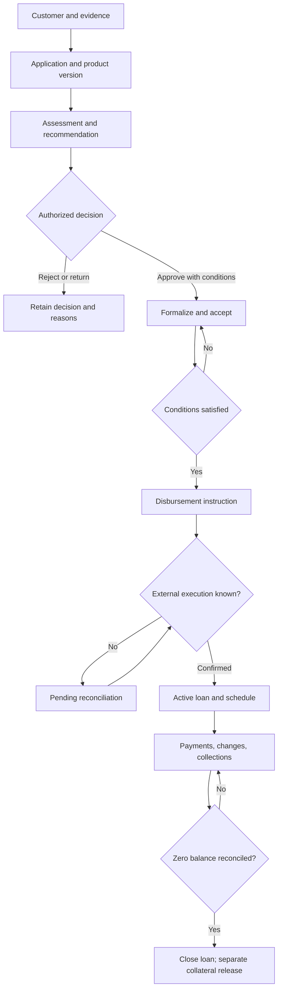

# LendCore business context and credit lifecycle

## Purpose and audience

This document gives a banking-domain orientation for analysts and developers working on LendCore. It explains the commercial lending problem, the parties and decisions in a loan's life, and the boundaries between LendCore and a bank's authoritative systems. It complements the product vision, requirements catalog, business rules, process catalog, and financial model; it does not approve a real credit policy or describe a software architecture.

## Banking context

A commercial bank receives funds from depositors and other funding sources and lends to individuals and businesses. A loan is a contractual obligation: the lender makes funds available under agreed terms, and the borrower repays principal, interest, and permitted charges on specified dates. The bank must assess whether repayment is reasonably supportable, explain the offer, execute funds correctly, maintain an accurate balance, and treat customers fairly throughout servicing and collection.

LendCore is a simulated specialized lending platform for a Peruvian commercial bank. It coordinates the credit lifecycle and retains operational evidence. It is not itself assumed to be a licensed bank. The external core banking system, where connected, remains authoritative for account balances and settlement; the general ledger remains authoritative for accounting entries. LendCore's operational ledger answers which loan events it recorded and how its contractual balance is derived. Reconciliation compares that record with external execution and accounting evidence.

## Participants and responsibilities

| Participant | Business responsibility | Boundary |
|---|---|---|
| Applicant/borrower | Requests credit, supplies information, accepts terms, repays | A legal entity acts through a currently authorized representative |
| Adviser | Captures need and application | Does not self-approve or execute own disbursement |
| Analyst | Verifies evidence, capacity, exposure, and risks; recommends | Recommendation is not the approval decision |
| Approver | Approves, conditions, returns, or rejects under delegation | Cannot exceed authority or bypass required second review |
| Operations/formalization | Checks conditions, issues terms, records acceptance, prepares servicing | Cannot change signed terms without amendment and acceptance |
| Disbursement/payment operations | Sends or reconciles an authorized monetary instruction | A sent instruction is not proof that money settled |
| Collections | Contacts, records promises/disputes, escalates within policy | A promise or collection note does not itself change debt |
| Legal, Compliance, Risk, Finance | Own policy, interpretation, accounting, and controls | The platform cannot make these institutional judgments by itself |
| External providers | Supply identity, bureau, account, payment, FX, valuation, or signature evidence | Their response has a source, time, status, and reliability boundary |

## Lifecycle and business meaning

1. **Customer and evidence.** Establish the person or entity, representatives, consent or other lawful basis, and relevant documents. A customer file may be incomplete without making the person nonexistent. Duplicates are reviewed rather than silently merged.
2. **Product and application.** A product version defines eligible segment, currency, rate type, repayment method, calendar, costs, and limits. The application records a specific request. Changing material facts after assessment makes affected analysis stale.
3. **Assessment.** The bank verifies income or business cash flow, current obligations, exposure, and ability to pay under a versioned method. Collateral may reduce loss if default occurs; it does not generate the cash needed to make installments. The engine can calculate and recommend, but an authorized person or approved policy makes the decision.
4. **Decision and conditions.** Approval is a time-bounded authority decision, sometimes subject to conditions such as verified documents, insurance, or perfected collateral. Rejection is retained with rationale; a materially changed request is a new or reopened case under policy.
5. **Contract and acceptance.** The customer receives the actual rate, payment dates, schedule, costs, and relevant disclosures. Accepted terms are snapshotted. A changed amount, beneficiary, or material term requires renewed review and acceptance.
6. **Disbursement.** Operations sends an authorized instruction to the nominated account or beneficiary. Pending or timed-out is an unknown execution state, not success or failure. Only an external confirmation or documented reconciliation makes the disbursement effective and activates the loan balance.
7. **Administration and payment.** The schedule divides each installment into principal, compensatory interest, and any separately permitted costs. A payment is received, settled, identified, applied under the applicable contract/legal priority, then reconciled. Those are separate facts and can fail at different points.
8. **Prepayment, delinquency, and change.** A principal prepayment reduces principal and future interest; an installment advance allocates money to future dues and is not equivalent. A past-due obligation can coexist with an active loan. Rescheduling changes future terms after authority and acceptance; refinancing creates a replacement obligation only when the new transaction is effective.
9. **Settlement and closure.** Closure requires confirmed funds, a reconciled zero contractual balance, and resolution of residuals. A certificate and collateral release are related but distinct activities. A write-off is an accounting/prudential event and does not automatically forgive the borrower's legal debt.

## Normal, exceptional, and failure outcomes

The successful path is not complete when a user clicks a button. Every external action has a request, a correlation/reference, and a result state. Missing evidence blocks only the next state that requires it and leaves the case recoverable. A provider outage creates pending/error and may permit a controlled manual alternative only when policy permits and equivalent evidence is retained. A duplicate message returns the original outcome; a duplicate identifier with different monetary content is investigated. A failure after external settlement creates a reconciliation case and recovery path; it must not cause a blind second execution. A confirmed error is corrected with a linked compensating event, preserving the original event and schedule history.

## Product boundaries and release context

MVP supports limited personal/business loans, one disbursement, fixed rates, PEN/USD, French/German amortization, monthly schedules, principal-only grace, simulated or adapter-based data, and controlled manual/import payment and collection flows. V1 adds variable rates, tranches, vehicle/mortgage milestones, weekly and every-15-day schedules, and more automation. The approved product decision covers all three frequencies across planned releases; this placement follows [scope](scope.md). Future scope includes specialized facilities and regulated reporting. Logical responsibilities in the product overview are business boundaries and do not imply separate deployable systems.

## Illustrative example

An individual requests PEN 10,000 over 12 monthly payments. The application contains verified take-home income, declared obligations, purpose, and consented bureau evidence. An analyst compares the proposed payment with policy-specific disposable income and checks PEN exposure. A supervisor approves subject to current identity and beneficiary checks. The customer accepts a French schedule. If the bank's transfer provider times out, the loan remains awaiting confirmation; operations queries the transfer before retrying. After confirmation, the schedule begins on the actual contractual value date. This example illustrates sequencing only; no income threshold, price, or approval policy is implied.

## Related material

See [shared glossary](glossary.md), [business rules](../03-business-rules/business-rules.md), [processes](../05-processes/processes.md), [financial model](../06-financial-model/financial-model-guide.md), [state machines](../08-domain-model/state-machines.md), and [assumptions and decisions](../10-project-governance/assumptions-and-decisions.md).
