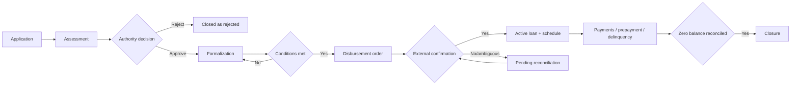

# Business processes

Each flow is technology-neutral. States and rules are in `08-domain-model/state-machines.md`.

## Process conventions

The actor named first is accountable for advancing the business case; external providers are evidence/execution parties, not decision-makers for LendCore. “Confirmed” means there is authoritative or reconciled evidence of the external event. A process may stop safely in a pending state and resume when evidence arrives. Every resumption revalidates authorization, current state, idempotency, and material data changes. No process step removes a confirmed event; correction follows PR-015.

## PR-001 — Customer registration
**Objective:** establish an identifiable, usable customer file. **Actors:** customer/representative, adviser, operations. **Inputs:** IDs, contacts, authority, documents, purposes/consents. **Precondition:** authenticated actor. **Steps:** capture → deduplicate → validate format/authority → check documents → flag or enable. **Decision:** duplicate/incomplete evidence goes to review. **Outcome:** draft/active/observed customer and audit trail. **Exceptions:** source outage suspends verification; correction creates a version. RN-001..005.

## PR-002 — Credit application
Capture need and terms → link current product → validate initial eligibility and file → obtain consent → submit for assessment. Missing documents leave the application incomplete; material data change versions the application and marks assessment stale. Outcome: received application. Actors: customer, adviser. RN-006..014.

## PR-003 — Credit assessment
Freeze data snapshot → query authorized sources → normalize income/debt/currency → calculate capacity, exposure, sensitivity → run versioned policy → show reasons, missing data, recommendation. Source unavailable: pending or authorized manual review; never silent approval. Analyst reviews consistency and records outcome. RN-015..022.

## PR-004 — Review and approval
Analyst completes assessment → determine band, exception, conflict → authorized decision-maker reviews → approve/condition/reject/return → obtain second approval where matrix requires → communicate rationale and validity. Material change or expiry restarts assessment. RN-023..027.

## PR-005 — Formalization and collateral
Operations verifies conditions, documents, acceptance, signature, and collateral; freezes contractual terms and schedule version. Real asset requires valuation/evidence/legal status under policy; unperfected collateral blocks any condition dependent on it. Material change requires reauthorization. RN-028..031, RN-064..070.

## PR-006 — Disbursement and loan creation
Verify effective contract and conditions → issue idempotent order → mark pending → receive external confirmation or reconcile → record principal and generate schedule from value date. Timeout: query, do not blindly resend. Rejection remains not disbursed. Tranches are V1. RN-032..044.

## PR-007 — Ordinary payment
Receive reference → validate currency/amount/loan → deduplicate → wait for settlement → calculate allocation at cut-off → atomically confirm movement/installment/balance → reconcile → issue receipt. Concurrent payment is serialized; insufficient payment is partial; excess requires instruction or suspense. Failure after confirmation opens discrepancy. RN-045..054.

## PR-008 — Partial/full prepayment
Customer requests quote/option → calculate as of date and expire quote → confirm mode (prepayment vs installment advance; lower payment vs shorter term) → confirm funds → revalidate balance → apply due amounts/accrual and principal → issue new schedule or zero balance → inform customer/release collateral through separate flow. Insufficient amount does not close loan. RN-055..062.

## PR-009 — Variable-rate review
Obtain fixing from contractual source → validate date/formula/margin/cap → approvals and required notice → create future-effective version → recalculate only unaccrued periods. Missing/invalid index escalates to Legal/Product; no arbitrary value. RN-063.

## PR-010 — Delinquency detection
At cut-off compare due obligation with effective allocations → mark installment partially/fully overdue → calculate simple interest on permitted base → alert. Pending/disputed payments are flagged for review. Delinquency is an independent attribute, not the contractual loan state. RN-071..074.

## PR-011 — Collections
Sort portfolio by age/exposure/strategy → assign agent → contact under rules → record attempt, channel, response, promise/dispute → follow up → escalate with authority. Promise does not change schedule; an arrangement takes effect only after approval/formalization. RN-075..076.

## PR-012 — Rescheduling
Simulate new frequency/dates and current principal → assess cause/capacity → verify prudential/contract treatment → approve/accept → create effective new version while preserving prior schedule and debt. Accrue interest to cut-off under contract. RN-077, RN-079..081.

## PR-013 — Refinancing
New assessment → approval and formalization → apply funds/compensation to old debt → only after confirmation mark old loan refinanced and create new obligation → retain link/history. Do not confuse an extended due date with debt replacement. RN-078..081.

## PR-014 — Settlement/closure
Calculate settlement as of date → confirm funds → allocate all due amounts → validate zero balance and reconciliation → close loan → issue certificate → initiate collateral release. Residuals/exceptions remain under investigation. RN-056, RN-058, RN-062.

## PR-015 — Reverse operation
Register error/complaint → locate original and verify external state → prepare compensation → obtain second approval → record reversal linked to original and value date → rebuild derived balance/schedule → reconcile and notify. Original remains intact; ambiguous operation is investigated first. RN-083..087.

## Cross-process exception and recovery rules

| Situation | Process response | Resume condition |
|---|---|---|
| User stops before external action | Preserve draft and completed validations; expire transient authorization/quote as configured | Reauthenticate/revalidate current permissions and data |
| User stops after a request may have reached a provider | Mark outcome unknown and query by the original correlation/idempotency key | Provider status or documented reconciliation establishes success/failure |
| Provider returns a definitive rejection | Keep the business object in rejected/needs-correction state; no financial movement | Correct the rejected field or obtain a newly authorized request |
| Callback is replayed | Match source key and payload; return stored result for identical replay | No extra movement; differing payload goes to investigation |
| Local processing fails after confirmed external event | Open discrepancy and recover the original event safely | Reconciliation links confirmation to one local movement/application |
| Customer or authorized staff reports an error | Link complaint/dispute to the affected evidence and freeze only the disputed decision/action as policy requires | Authorized resolution records evidence, rationale, and any compensating action |

The end-to-end success criteria are (a) every state has an owner and next action, (b) every financial effect has exactly one effective record, (c) an unknown external outcome is never represented as completed, and (d) interruption can be resumed without losing the original evidence.
